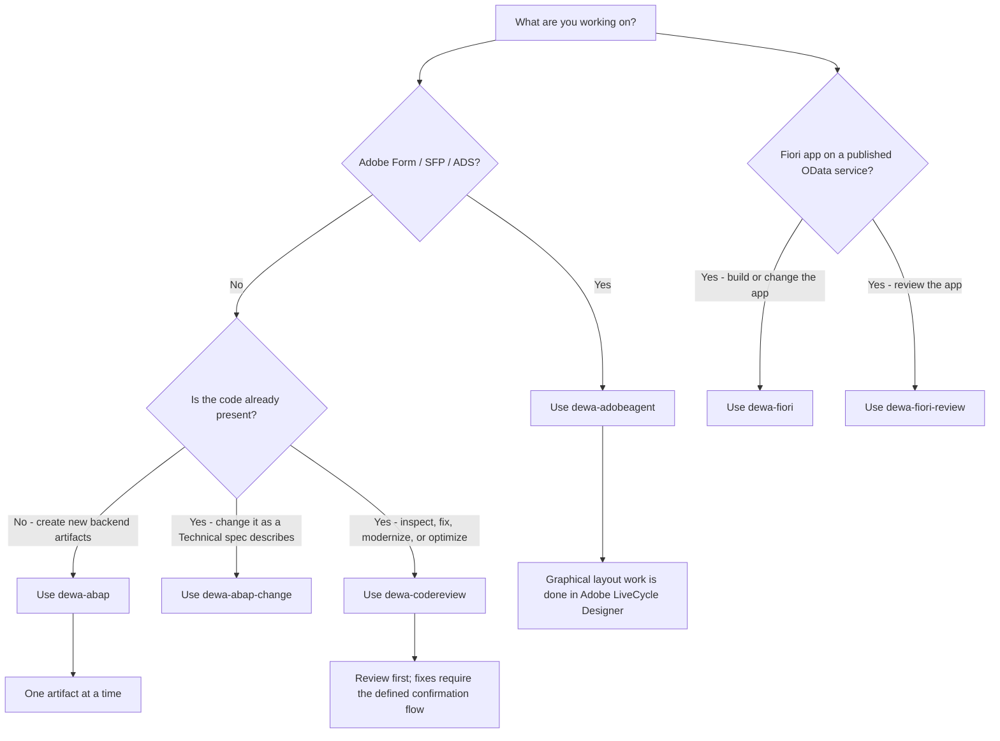
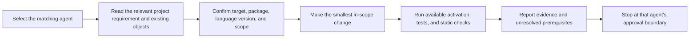
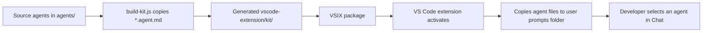

# DEWA Agent Workflows

A practical guide to choosing and working with the DEWA backend agents. The source of truth for exact rules remains each agent file under `agents/` and the shared router in `AGENTS.md`.

## At a Glance

| Agent | Choose it for | Main output | User checkpoint |
| --- | --- | --- | --- |
| `dewa-abap` | Building new ABAP, CDS, RAP, or CAP backend artifacts | One new/changed artifact at a time, with tests and validation status | Type `CONFIRM ARTEFACT` before the next artifact |
| `dewa-abap-change` | Changing existing custom ABAP objects exactly as a Technical spec describes (objects with status *change*) | One changed object at a time: diff, impact, activation / ABAP Unit / ATC evidence, how to revert | Type `CONFIRM CHANGE` before every write |
| `dewa-fiori` | Building or changing the SAP Fiori app of a Technical spec (Fiori elements, FPM extensions or freestyle SAPUI5) on a published OData service | One app at a time: service verified, app generated with SAP Fiori tools, manifest validation / UI5 linter / build results, acceptance checks | `CONFIRM CHANGE` before changing an existing app, `CONFIRM DEPLOY` before deploying |
| `dewa-fiori-review` | Reviewing Fiori / UI5 front ends: security (XSS, injection, CSRF, secrets, CSP, dependencies, backend authorization), SAP standards, accessibility, i18n, performance, tests, and the Technical spec | Verdict, tool results, findings with severity, `file:line` and evidence; fixes for accepted findings | Y/N per finding, `CONFIRM FIX` before any change |
| `dewa-codereview` | Reviewing or safely improving existing ABAP, CDS, RAP, or CAP code | Full review report, findings, safe fixes, and optionally an as-built technical specification | Answer Y/N for flagged changes; type `CONFIRM REVIEW` before handoff |
| `dewa-adobeagent` | Building or maintaining SAP Adobe Forms and their ABAP integration | Form interface, form object/context, data provider or driver, and validation evidence | One artifact at a time; no named confirmation keyword is specified in this agent |

The backend agents are backend-focused; `dewa-fiori` builds the front end on top of the published service. The backend agents and use the ADT MCP server for SAP repository operations where available. They do not replace target-system authorization, SAP activation, ATC, ABAP Unit, Basis/ADS checks, or required technical approvals.

## How to Choose

The agents are separate entry points, not a dependency chain. A typical handoff is optional: build with `dewa-abap`, then review the result with `dewa-codereview`; for an Adobe Form, use `dewa-adobeagent` for ABAP/form-contract work and LiveCycle Designer for graphical layout.

## Shared Session Pattern

Before SAP backend changes, establish the target and inspect the local context. The exact checklist depends on the agent, but commonly includes the target system/release, package/software component, ABAP language version, existing objects, test coverage, transport context, and the functional requirement. Do not guess system facts or claim checks that were not run.

In the ADT virtual workspace, repository files may be virtual. Follow the agent's directory-first navigation instructions and use the ADT MCP server for SAP operations. A file edit alone does not prove that an SAP object activated or passed tests/ATC.

## `dewa-abap`: Build New Backend Work

Use for new backend implementation: ABAP classes, CDS, RAP, CAP, and related service artifacts. The agent treats `BUSINESS_REQUIREMENTS.md` as the requirement source when present and follows the project's target and package rules.

### Build Flow

1. Confirm target/release, tier, backend model, OData version, draft requirement, entity structure, package, language version, and existing repository context. Use applicable DEWA defaults rather than repeatedly asking for already-confirmed defaults.
2. For approved cloud-ready development, check the assigned `ZS4DEWA_CLOUD` software component and approved `ZCLOUD_ROOT`/module package. Otherwise follow the project package convention. Never assume package assignment without target context.
3. Choose the implementation path:
   - RAP for new transactional OData V4 business objects.
   - CAP for BTP side-by-side applications.
   - Standalone OO ABAP only for suitable non-RAP business logic.
4. For RAP, follow the declared dependency order: persistence table; draft table only when explicitly required; interface/root/projection CDS; metadata extension and access control; interface/projection behavior definitions; behavior implementation and tests; service definition; service binding.
5. Create one artifact, validate it, and present its result before proceeding. Do not batch the generation order.
6. Add the required unit-test stub with each handler/service. Run unit tests after source changes using the ADT MCP server where available. Activate changed development objects as part of the authorized development workflow; report failures or unavailable checks.
7. Run the applicable target-mandated ATC/Clean Core checks in ADT. Report the actual variant and result; do not claim a pass without tool evidence.
8. Present the artifact, changes, activation/test/ATC evidence, and open items. Stop until the developer types the exact keyword `CONFIRM ARTEFACT` before creating the next artifact.

### Important Boundaries

- No unrequested RAP draft behavior.
- Do not use `COMMIT WORK` for RAP; use RAP transaction handling and EML as required.
- Use released APIs for ABAP Cloud. If release status is unknown, stop before depending on the object from Cloud code.
- Do not directly change production, release transports, or import transports without required explicit approval.
- Review for Clean Core and security evidence through the target system/ATC, not code appearance alone.

## `dewa-abap-change`: Change Existing Code from a Technical Spec

Shipped with the DEWA SAP Spec Builder extension (installed into the VS Code prompts folder next to
`dewa-fs-discovery`; agent file `vscode-extension-addon/agents/dewa-abap-change.agent.md`, also as the skill
`docs/agent-kit/skills/abap-change/SKILL.md`). Use it when a Technical spec lists objects under **Existing Objects to
Change**. The Spec Builder routes the hand-off: new objects → `dewa-abap`, changed objects → `dewa-abap-change`,
both → *Build new objects* first, then *Change existing objects*. Its prompt starts with `DEWA-ABAP-CHANGE v1`.

### Change Flow (per object, in the spec's order)

1. Stop if the spec is not approved (the instructions start with **STOP**) or what this object needs is `[TO BE CONFIRMED]`.
2. Read the current source / definition read-only (and the spec's *Current State in SAP*); check locks.
3. Where-used for changed signatures, interfaces, structures or fields → impact list.
4. Show the exact diff (changed lines with context), the impact, the transport / package and what stays untouched.
5. Write only after the developer types `CONFIRM CHANGE`: lock, edit, save, unlock, activate.
6. Run the object's ABAP Unit tests and ATC (clean core variant); report the real evidence.
7. Report what changed and how to revert, then wait for `CONFIRM CHANGE` before the next object.

### Important Boundaries

- Only objects listed as *change*, only the customer namespace; never SAP standard (enhancement points / BAdIs only when the spec names them); never unrelated code.
- Keep signatures and structures backward compatible unless the spec says otherwise.
- No business data changes, no transport release / import, no production.

## `dewa-fiori`: Build the Fiori App of a Technical Spec

Shipped with the DEWA SAP Spec Builder extension (agent file `vscode-extension-addon/agents/dewa-fiori.agent.md`,
also as the skill `docs/agent-kit/skills/fiori-build/SKILL.md`). The Spec Builder hands every Fiori/UI5 object
(new or change) to `dewa-fiori`; backend objects stay with `dewa-abap` / `dewa-abap-change`, and the choice dialog
puts the Fiori app last because it needs the published service. Its prompt starts with `DEWA-FIORI v1`.

### Tools (MCP servers by SAP, versions pinned)

| Server name | Package | Used for |
| --- | --- | --- |
| `fiori-mcp` | `@sap-ux/fiori-mcp-server` (SAP Fiori tools) | `list_sap_systems`, `download_odata_service_metadata`, `generate_fiori_app_odata`, `list_fiori_apps`, `list_functionality` → `get_functionality_details` → `execute_functionality` (pages, building blocks, extensions, manifest settings), `search_docs` |
| `ui5-mcp` | `@ui5/mcp-server` | `get_guidelines`, `get_api_reference`, `get_version_info`, `run_manifest_validation`, `run_ui5_linter`, `create_ui5_app` |
| `sap-abap-adt` | the ABAP ADT MCP server | read-only: service binding, service definition, CDS, BDEF, metadata extension |

Setup: **nothing to copy** – the DEWA SAP Spec Builder extension provides `fiori-mcp` and `ui5-mcp` by default
(VS Code 1.101+ registers them through its MCP provider API; VS Code asks once to trust / start them). On older
VS Code the extension offers **Add to my mcp.json** once. Settings `dewaSpecBuilder.fioriMcp.*`: `enabled` (default
on), `fioriServerVersion` / `ui5ServerVersion` (pinned), `allowedDomains` (add the SAP host), `caCertFile` (DEWA's
root CA). A server you define yourself in an `mcp.json` under the same name is left to you. **DEWA: Check Fiori MCP
servers** shows the status (Node.js 20.17+ needed). Telemetry of SAP Fiori tools is off
(`SAP_UX_FIORI_TOOLS_DISABLE_TELEMETRY=true`). Manual setup without the extension:
[`docs/agent-kit/fiori/mcp.example.json`](agent-kit/fiori/mcp.example.json). Optional: SAP's own skills for Fiori development come
with the `sap-ux-fiori-tools` plugin (Copilot Chat → `@agentPlugins`, or `copilot plugin install
sap-ux-fiori-tools@awesome-copilot`); `dewa-fiori`'s rules still apply on top.

### Build Flow (per app)

1. Stop if the spec is not approved or the floorplan, service binding, main entity set, app ID or layout
   (columns / sections, or views / routes for freestyle) is missing or `[TO BE CONFIRMED]`.
2. Verify the service in SAP (read-only) and download its metadata. Anything the spec names that the metadata does not
   have is a **backend gap** for `dewa-abap` / `dewa-abap-change` – never invented in the UI.
3. Generate the app with SAP Fiori tools (floorplan template `FE_LROP`, `FE_WORKLIST`, `FE_ALP`, `FE_OVP`, `FE_FEOP`,
   `FE_FPM`, or `FF_SIMPLE` / `create_ui5_app` for freestyle); further changes through the MCP functionalities.
4. UI annotations stay in the backend metadata extension; local `annotation.xml` only for app-specific items;
   `metadata.xml` is never edited.
5. Freestyle: `get_guidelines` first, `get_api_reference` before any control or method, i18n for every text, no
   deprecated APIs.
6. Manifest validation, UI5 linter, Fiori ESLint plugin, `npm run build`, preview; acceptance checks pass / fail.
7. Deploy to the ABAP repository (BSP name, package, transport from the spec) only after `CONFIRM DEPLOY`; never
   production.

### What the Technical spec needs for a Fiori app

| Area | Content |
| --- | --- |
| App | Floorplan, app ID / namespace, title, minimum SAPUI5 version, devices |
| Service | Service binding / main entity set, OData version, service URL, SAP system for the metadata, draft |
| List report | Filter fields (mandatory, default, value help), table columns (label, importance, position), table type, initial load |
| Object page | Header (title, description, header facets), sections (field group / child table / chart / custom) |
| Actions | Action as in the BDEF, button text, placement, confirmation, side effects |
| Value helps & texts | Field, value help entity, text field, "show as" (text arrangement) |
| Annotations | Backend DDLX only, or the app-specific local list |
| Extensions (FPM) | Building blocks, custom columns / sections / actions / pages, controller extensions |
| Freestyle | Layout, views (controls, binding, user actions), routes, models, controller logic |
| Navigation & launchpad | Inbound semantic object – action, outbound targets, tile, catalog / space / page, business role |
| Deploy | Target, BSP application name, package, transport |
| Tests | OPA5 journeys and UI acceptance checks |

## `dewa-fiori-review`: Review a Fiori / UI5 Front End

Shipped with the DEWA SAP Spec Builder extension (agent file `vscode-extension-addon/agents/dewa-fiori-review.agent.md`,
also as the skill `docs/agent-kit/skills/fiori-review/SKILL.md`). Start it from the Copilot Chat agent picker for any
app, or from the builder's hand-off (*Review the Fiori app*, prompt `DEWA-FIORI-REVIEW v1`), which also checks the
app against the Technical spec. `dewa-fiori` recommends it before deploying.

1. **Tool checks, real output:** `run_ui5_linter`, `run_manifest_validation`, the Fiori ESLint plugin
   (`@sap-ux/eslint-plugin-fiori-tools`), `npm audit --omit=dev`, `npm run build`, `npm test`.
2. **Source scan with fixed patterns:** OData `$filter` / key concatenation, HTML / code injection, open redirects,
   requests bypassing the model, secrets, insecure / hard-coded URLs, browser storage, debug output, TLS switched off,
   hard-coded texts, icon-only buttons, synchronous loading, reads in loops. The linter and ESLint do not report most
   of these. A sample app with planted issues: the linter found the legacy / global / manifest issues and ESLint
   found `innerHTML`, `eval`, `alert`; the `$filter` injection, API key, `http://` URL, `jQuery.ajax` POST, hard-coded
   texts and the icon-only button were found only by the scan.
3. **Catalogue:**
   - SEC: XSS / injection, OData / URL injection, backend authorization (DCL, BDEF) read-only, CSRF, secrets / data
     protection, CSP / framing / transport, dependencies / deploy configuration;
   - STD: UI5 modern APIs, Fiori elements rules, manifest, i18n / RTL, accessibility (WCAG 2.1 AA), theming,
     messages, clean code;
   - PERF: loading, OData (`$select`, paging, N+1, batch), rendering, memory, assets;
   - TEST; SPEC.
4. **Report:** verdict (Approve / Approve with fixes / Reject), tool results, findings (ID, severity, `file:line`,
   evidence, reference, fix), backend findings.
5. **Fix:** Y/N per finding → diff → `CONFIRM FIX` → apply → re-run the checks. Never backend objects,
   `metadata.xml` or deploy.

## `dewa-codereview`: Review Existing Code

Use for code that already exists when the task is to inspect quality, refactor safely, modernize, or optimize. It is not the primary agent for creating a new application from scratch.

### Review and Fix Flow

1. Select one object. Read its source and tests. Review the full object before presenting findings; do not stream partial results.
2. Analyze the object across performance (`PERF`), style (`STY`), security (`SEC`), modernization/Clean Core, and performance optimization checks.
3. Present the complete review report before changing anything. Review is read-only until the developer confirms fixes.
4. Safe, behavior-preserving fixes may be applied according to the agent rules. Present flagged or behavior-affecting suggestions and obtain a clear Y/N decision before applying them.
5. **Never auto-fix security findings.** Report them for remediation. Critical security findings block handoff; escalate the specified critical authorization concern to the security owner.
6. After fixes, activate the object, rerun ABAP Unit tests, and run ATC when available. Confirm no new violations; report anything not run.
7. Always show the complete review report in chat; this is the guaranteed delivery path for developers working in an ADT virtual workspace.
8. Offer an optional Desktop copy with a `cmd.exe` command, for example `notepad "%USERPROFILE%\Desktop\review_report_zcl_fi_invoice_processor.md"`. The developer runs it, copies the report from chat into Notepad, and saves. Never claim the file was saved unless the developer confirms it.
9. Stop at the review gate. The developer must type `CONFIRM REVIEW` before handoff and generation of the as-built technical specification.
10. After confirmation, generate the technical specification from actual changes and validation evidence, show it in chat, and offer a similar Desktop-save command. Do not invent test, ATC, activation, or performance results.

The agent must not attempt to create report files inside the ADT virtual workspace; it has no local file storage.

### Review Output Categories

- **Auto-fixed:** safe behavior-preserving changes made, with locations and rationale.
- **Flagged:** changes that need a developer decision, including behavior risk.
- **Security:** findings are report-only and never auto-fixed.
- **Performance:** recommendations; measure uncertain/high-impact changes with approved runtime or SQL analysis rather than guessing.

## `dewa-adobeagent`: Adobe Forms and ABAP Integration

Use for SFP/ADS form interfaces and objects, form context, ABAP data providers/drivers, output integration, and PDF-render troubleshooting. It owns the ABAP side and form contract. Graphical XDP layout changes belong in Adobe LiveCycle Designer.

### Form Delivery Flow

1. Confirm document type, trigger, data source and keys, output channel, language/country needs, existing reusable form objects, and interface type. Dictionary-based is the default for ABAP callers; ask explicitly before choosing XML Schema-based.
2. Design the contract and objects separately. The expected structure is a form interface, a form object/context, a LiveCycle layout inside the form, and a caller implemented as a thin driver plus a testable data provider where applicable.
3. Generate in order, one artifact at a time: interface then activate; form/context then activate; driver/data-provider then activate. Do not collapse these contracts into one artifact.
4. Keep data selection and display formatting in the data provider. Keep the driver thin. Resolve the generated form function-module name at runtime; do not hardcode the generated name.
5. Run the applicable data-provider ABAP Unit tests, activation, ATC, SFP preview, and end-to-end render checks where the environment permits. Confirm PDF output and ADS connectivity when required. Keep `FP_JOB_CLOSE` guaranteed on errors.
6. Report exactly which checks passed and which could not be run. Do not mark the task complete based only on ABAP activation if form binding, rendering, or delivery is still unverified.
7. Clearly identify remaining work outside the agent, such as LiveCycle Designer layout updates, ADS/Basis prerequisites, or print destination setup.

### Form-Specific Boundaries

- Preserve transported interface parameters; add optional parameters rather than removing or retyping contract fields.
- Do not put database reads or business logic in form code initialization.
- Format amounts, dates, units, addresses, and translated display text in ABAP before the form consumes it.
- Treat customer, financial, and tax data as sensitive. Do not use real production data in examples or committed fixtures.
- Do not invent ADS destinations, printers, SAP object names, or render results.

## VS Code Extension Distribution

The VS Code extension is a delivery mechanism for the agent files; it does not create a runtime dependency between agents.

- The extension bundles `agents/*.agent.md` into `vscode-extension/kit/` during packaging.
- On startup, `extension.js` copies bundled agent files into `%APPDATA%\Code\User\prompts` when `dewaAbapAgent.autoInstall` is enabled.
- Agent copies refresh when the extension version changes. The reinstall command can copy them again manually.
- `skills/` and the root `AGENTS.md` router belong to the repository-level kit workflow; the VS Code extension package described here bundles and installs agents only.
- Installing files makes agents available; it does not auto-select an agent, connect to SAP by itself, or validate ABAP code.

## Quick Comparison

| Concern | `dewa-abap` | `dewa-codereview` | `dewa-adobeagent` |
| --- | --- | --- | --- |
| Main task | Build new backend artifacts | Review/fix existing backend objects | Build/maintain Adobe Forms and ABAP integration |
| Primary focus | RAP/CAP/CDS/ABAP implementation | PERF/STY/SEC and safe refactoring | Form contract, data provider, driver, output/render |
| Work unit | One artifact at a time | One object at a time | One form artifact at a time |
| Human gate | `CONFIRM ARTEFACT` between artifacts | Y/N for flagged fixes, then `CONFIRM REVIEW` | Sequential artifact workflow; no named keyword in the agent file |
| Specialized manual work | SAP system activation/ATC/tests | Security owner sign-off for critical findings | Adobe LiveCycle Designer and possible Basis/ADS work |

## Source Files

- `AGENTS.md`: repository-level router and shared process rules.
- `agents/dewa-abap.agent.md`: new backend development.
- `agents/dewa-codereview.agent.md`: existing-code review/refactor/optimization.
- `agents/dewa-adobeagent.agent.md`: Adobe Forms and ABAP-side delivery.
- `vscode-extension/extension.js`: agent installation into the VS Code user profile.
- `vscode-extension/scripts/build-kit.js`: packaging source agents into the extension bundle.
